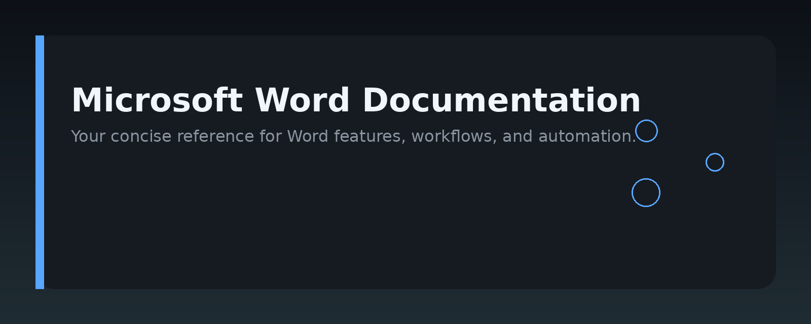
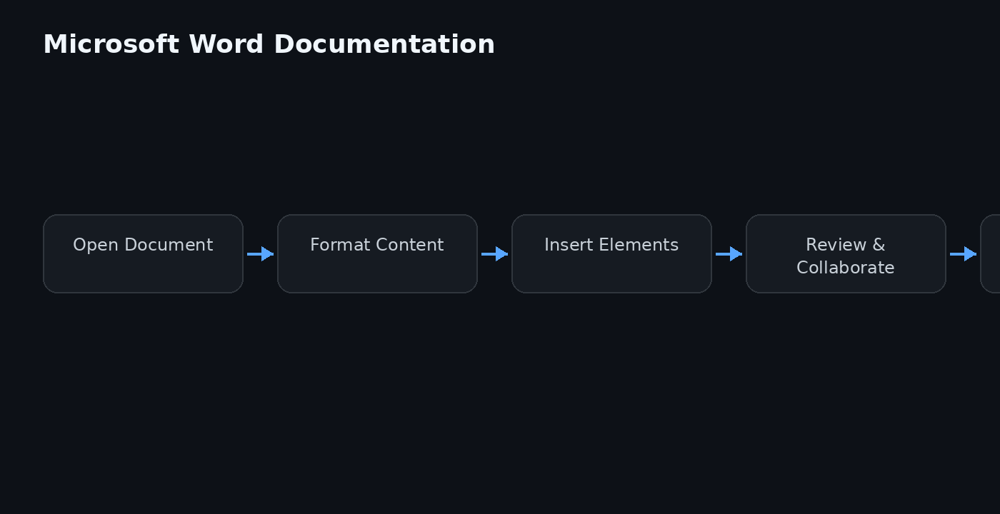

# Microsoft Word Documentation




## Overview

This repository is a practical, developer-oriented knowledge base for working with Microsoft Word programmatically. It covers document automation, formatting, templates, and integration patterns using VBA, Office.js, and Python libraries like `python-docx`. The goal is to help you build reliable tools that generate, parse, and manipulate Word documents without opening the GUI.

## Why it exists

Most Microsoft Word documentation is either end-user tutorials or scattered API references. Developers often need a single place to understand how Word documents are structured, how to automate repetitive tasks, and how to avoid common pitfalls like corrupted files or broken styles. This repo fills that gap with concise, tested examples and clear explanations of the underlying architecture.

## Core concepts

- **Document Object Model (DOM):** Word files are ZIP archives containing XML parts. The main content lives in `word/document.xml`, with styles, settings, and relationships in sibling parts.
- **Content controls:** Reusable, tagged regions in a document that can be mapped to data sources or manipulated via code.
- **Styles and formatting:** Paragraph, character, and table styles control appearance. Direct formatting overrides styles and can cause inconsistency.
- **Templates (.dotx):** Pre-built documents with placeholders, used as starting points for automation.
- **Compatibility modes:** Word files carry a `w:compat` setting that affects how features behave across versions.

## Architecture


The diagram above shows the main layers:

1. **File layer:** `.docx` is a ZIP package with XML parts and relationships.
2. **Object model layer:** The in-memory representation (e.g., `Document`, `Paragraph`, `Range`) that APIs expose.
3. **API layer:** VBA (COM), Office.js (web add-ins), and third-party libraries like `python-docx`.
4. **Application layer:** Word itself, which renders and edits the document.

Each layer has its own strengths. VBA is best for macro-driven tasks inside Word. Office.js works in Word on the web and desktop. `python-docx` is ideal for server-side batch processing.

## Practical workflow

A typical automation workflow looks like this:

1. **Define the template:** Create a `.dotx` with content controls or bookmark placeholders.
2. **Choose your API:** Use VBA for in-app macros, Office.js for add-ins, or `python-docx` for scripts.
3. **Populate data:** Map your data source (JSON, CSV, database) to the placeholders.
4. **Generate output:** Save as `.docx`, `.pdf`, or `.docm` depending on needs.
5. **Validate:** Check for missing fields, broken styles, or oversized files.

## Examples

### VBA: Fill a content control

```vba
Sub FillContentControl()
    Dim cc As ContentControl
    Set cc = ActiveDocument.ContentControls(1)
    cc.Range.Text = "Hello from VBA"
End Sub
```

### python-docx: Create a document with a heading

```python
from docx import Document

doc = Document()
doc.add_heading("Project Report", level=1)
doc.add_paragraph("This paragraph was generated programmatically.")
doc.save("report.docx")
```

### Office.js: Read the selected text

```javascript
Word.run(function (context) {
    var range = context.document.getSelection();
    range.load("text");
    return context.sync().then(function () {
        console.log(range.text);
    });
});
```

### Extract text from a .docx with Python

```python
from docx import Document

doc = Document("input.docx")
for para in doc.paragraphs:
    print(para.text)
```

## FAQ

**Q: Why does my generated .docx fail to open in Word?**
A: Usually because the XML is malformed or a relationship is missing. Validate your output by opening it in a text editor and checking the XML structure.

**Q: Should I use VBA or python-docx?**
A: Use VBA when the macro must run inside Word and interact with the live document. Use python-docx for batch processing, headless servers, or when you want to avoid Word being installed.

**Q: How do I preserve formatting when replacing text?**
A: Avoid replacing the entire `Range.Text` if the paragraph has complex formatting. Instead, target the specific run or use content controls with mapped data.

**Q: Can I convert .docx to PDF without Word?**
A: Yes, using LibreOffice in headless mode or libraries like `docx2pdf` (which still requires Word on Windows/macOS). For server-side conversion, LibreOffice is the common choice.

## License

MIT

Topic: `microsoft-word-documentation`
